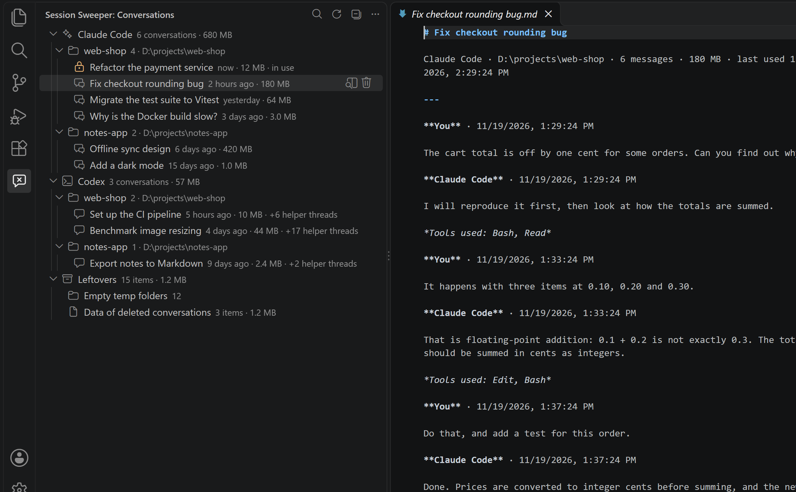
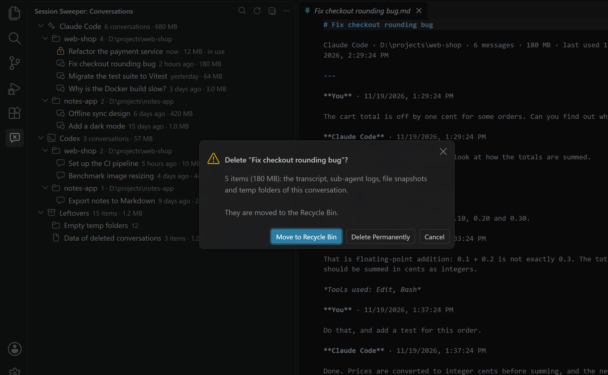

# Session Sweeper for Claude Code & Codex

> Unofficial. Not affiliated with, or endorsed by, Anthropic or OpenAI.

[简体中文](README.zh-CN.md)

A side panel for VS Code that lists your local **Claude Code** and **Codex** conversations and deletes one *completely* when you ask it to.

Neither tool's VS Code extension really deletes a conversation, and doing it by hand is harder than it looks, because a conversation is not one file. Claude Code spreads it over a transcript, a data folder with sub-agent logs and tool output, file snapshots, an environment folder, telemetry files and one or more temp folders. Codex keeps it in a rollout file, an index, several SQLite databases, and in the review and sub-agent threads it creates on the side, each of which holds a copy of what you said. Session Sweeper knows where all of that is.



## What it does

- **One list for both tools.** Grouped by folder, with title, last use and the disk space each conversation really takes (a 200 MB transcript can sit on top of 5 GB of sub-agent logs).
- **Search by what was said.** Finds the conversations in which you or the assistant used a phrase. Text the tools inject (reminders, memory, file contents) is ignored, so a word from a memory note does not match everything.
- **Preview before you delete.** Opens what was said as plain text. Nothing is rendered and nothing is fetched.
- **Complete deletion.** See [what is removed](#what-is-removed).
- **Never deletes what is open.** Conversations in use are marked with a lock and skipped. See [how that is detected](#how-in-use-is-detected).
- **Recycle Bin by default.** Claude Code data is moved to the Recycle Bin / Trash, so a mistake can be undone. You can switch to permanent deletion.
- **Leftover cleanup.** Finds what already-deleted conversations left behind: empty temp folders, orphaned snapshots, Codex review threads whose conversation is gone.
- **Local only.** No telemetry, no account, and no network requests of its own. It reads and deletes files on your machine; for Codex it runs Codex's own `codex delete`.
- English and 简体中文.

## Install

Download the `.vsix` file from the [latest release](https://github.com/HeLanGouSheng/session-sweeper/releases/latest), then in VS Code open the Extensions view, choose **…** → **Install from VSIX…**, and pick the file. Or from a terminal:

```
code --install-extension session-sweeper-<version>.vsix
```

It works in editors built on VS Code 1.90 or later.

## Use

Click the speech-bubble icon in the Activity Bar.

- Hover a conversation and click the **trash** icon, or select several and press it once. A dialog says exactly how many items and how much space go, and where to.

  

- The **preview** icon next to it opens what was said, as plain text.
- The **magnifier** in the panel title searches; the icon next to it clears the search.
- **Leftovers**, at the bottom, has a clean-up button of its own.
- Right-click a conversation for more: delete permanently, reveal the transcript file, copy the ID. The Delete key works on the selection.

Searching, deleting and cleaning up are also in the Command Palette under **Session Sweeper**.

Claude Code and Codex read their history when they start. If a deleted conversation still shows in one of them, reload the editor window.

## What is removed

**Claude Code** (from `~/.claude`, or `CLAUDE_CONFIG_DIR`)

| What | Where |
| --- | --- |
| The transcript | `projects/<folder>/<id>.jsonl` |
| Sub-agent transcripts, tool output, workflows | `projects/<folder>/<id>/` |
| Snapshots of files it edited | `file-history/<id>/` |
| Environment data | `session-env/<id>/` |
| Queued telemetry events | `telemetry/*<id>*` |
| Scratch files, background command output, pasted images | `<temp>/claude/<project>/<id>/` |
| Your prompts in the input history, where they carry the conversation's ID | lines in `history.jsonl` |
| Its entry in the session index some versions keep per project | `projects/<folder>/sessions-index.json` |

Anything else in the data folder that carries the conversation's ID in its name is removed too.

If the same conversation exists in two project folders, each copy is a row of its own. Deleting one row removes that copy; the data both copies share goes with the last one.

**Codex** (from `~/.codex`, or `CODEX_HOME`)

Codex conversations are deleted by Codex itself, with its `codex delete` command, because their content also lives in Codex's databases, which only Codex should edit. Session Sweeper adds what that command leaves out:

| What | How |
| --- | --- |
| The conversation: rollout file, index entry, database rows, sub-agent threads | `codex delete` |
| Review ("guardian") threads Codex created for it, which `codex delete` does not remove | `codex delete`, once per thread |
| Your prompts in the input history | lines in `history.jsonl` |

Codex deletes permanently; there is no Recycle Bin for it.

## What is not removed

- **Files a conversation created or changed in your projects.**
- **Claude Code memory notes and plans.** They are shared between conversations.
- **Conversation IDs remembered elsewhere**, without content: Claude Code's VS Code extension keeps the IDs of archived conversations in its own editor state.
- **The Codex desktop app's catalog** (`sqlite/codex-dev.db`), which stores the title and folder of conversations the desktop app has listed.
- **Deleted rows inside Codex's database files** until SQLite reuses the space. Codex and ordinary tools cannot see them, but the bytes are still on disk.
- **Other conversations that quoted this one.**
- **Anything stored on Anthropic's or OpenAI's servers.**

## How "in use" is detected

- **Claude Code** registers each running session with its process ID. A conversation is in use when that process is running and really is Claude Code (process IDs get reused).
- **Codex** holds a lock on each conversation it has loaded, and keeps holding it after you close the conversation's tab, until the editor window is closed. On Windows the lock can be seen and the conversation is marked. On macOS and Linux an extension cannot see it. There Session Sweeper relies on Codex itself: it asks Codex to delete the conversation before anything else, and if Codex refuses, nothing is removed and you are told to close the editor first.
- For both, a transcript written to in the last 30 seconds counts as in use.

A check is made when the list is shown and again right before deleting.

## Settings

| Setting | Default | Meaning |
| --- | --- | --- |
| `sessionSweeper.deleteMode` | `trash` | `trash` moves Claude Code data to the Recycle Bin / Trash, `permanent` deletes it. |
| `sessionSweeper.groupBy` | `folder` | `folder` or `none`. |
| `sessionSweeper.sortBy` | `modified` | `modified`, `size` or `title`. |
| `sessionSweeper.claude.dataDir` | | Claude Code data folder, if it is not in the usual place. |
| `sessionSweeper.codex.dataDir` | | Codex data folder, if it is not in the usual place. |
| `sessionSweeper.codex.executablePath` | | The Codex program to use. By default: the one bundled with the Codex extension, then the one on `PATH`. |

The path settings can only be set per machine, never by a workspace, so opening a project cannot redirect the extension.

## Compatibility

Developed and tested on Windows 11 with Claude Code 2.1 and Codex CLI 0.169. The automated tests also run on macOS and Linux.

The storage formats of both tools are undocumented and change without notice. Session Sweeper is written to fail safe: files it does not recognise are not listed, and what is not listed is never deleted. If a new version of either tool stores something in a new place, that place will be missed until this extension is updated. [Please report it.](https://github.com/HeLanGouSheng/session-sweeper/issues)

## Development

```
npm install
npm run verify            # type check, lint, unit tests, translation check
npm run test:integration  # runs the extension in a real VS Code, on fake data
npm run test:ui           # clicks through the panel, dialogs and menus, on fake data
npm run screenshot        # retakes the pictures in this file
npm run package           # builds the .vsix
```

Press F5 in VS Code to try a development build. The tests never touch real conversations: unit tests build fake data folders, and everything that starts a VS Code points the extension at a scratch folder through `CLAUDE_CONFIG_DIR`, `CODEX_HOME` and `SESSION_SWEEPER_CLAUDE_TEMP`. `node scripts/demo-data.mjs <folder>` creates the made-up conversations shown in the pictures.

## License

[MIT](LICENSE)
