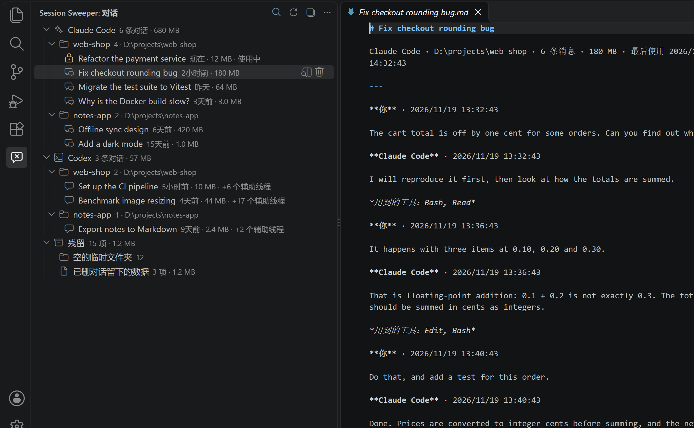
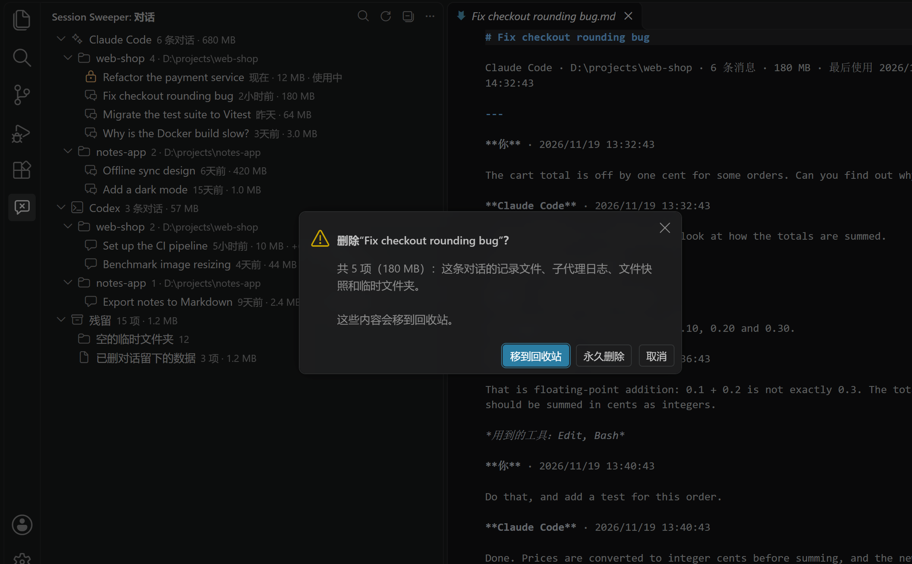

# Session Sweeper for Claude Code & Codex

> 非官方工具，与 Anthropic、OpenAI 无关，也未获其认可。

[English](README.md)

VS Code 里的一个侧边面板：列出本机的 **Claude Code** 和 **Codex** 对话，要删哪条，就把那条**彻底**删掉。

这两个工具的 VS Code 扩展都没有真正的「删除对话」，手动删又比看上去难，因为一条对话不是一个文件。Claude Code 把它分散在好几处：对话记录、放子代理日志和工具输出的数据文件夹、文件快照、环境文件夹、遥测文件，还有一个或几个临时文件夹。Codex 把它存在记录文件、索引和几个 SQLite 数据库里，另外它在后台开的审查线程和子代理线程里，也各有一份你说过的话。这些地方 Session Sweeper 都知道。



## 能做什么

- **两个工具一个列表。** 按文件夹分组，显示标题、最后使用时间，以及每条对话实际占用的磁盘空间（一个 200 MB 的对话文件，背后可能有 5 GB 的子代理日志）。
- **按说过的话搜索。** 找出你或 AI 说过某句话的对话。工具自动插入的内容（提醒、记忆、文件内容）不算，所以搜记忆笔记里的词，不会所有对话都命中。
- **删之前先预览。** 把对话内容以纯文本打开。不渲染，也不联网。
- **彻底删除。** 见[会删掉什么](#会删掉什么)。
- **不会删正开着的对话。** 使用中的对话带锁标记，会被跳过。见[怎么判断「使用中」](#怎么判断使用中)。
- **默认进回收站。** Claude Code 的数据会移到回收站 / 废纸篓，误删可以找回。也可以改成永久删除。
- **清理残留。** 找出以前删掉的对话留下的东西：空的临时文件夹、没了主人的快照、对话已不在的 Codex 审查线程。
- **只在本机运行。** 不收集数据、不需要账号，扩展自己不发任何网络请求。它只读取和删除你电脑上的文件；删 Codex 对话时会调用 Codex 自带的 `codex delete`。
- 界面有英文和简体中文。

## 安装

到[最新发布页](https://github.com/HeLanGouSheng/session-sweeper/releases/latest)下载 `.vsix` 文件。在 VS Code 里打开扩展视图，点 **…** → **从 VSIX 安装…**，选中这个文件。也可以在终端里运行：

```
code --install-extension session-sweeper-<版本号>.vsix
```

适用于基于 VS Code 1.90 及以上版本的编辑器。

## 使用

点活动栏里的对话气泡图标。

- 鼠标移到某条对话上，点**垃圾桶**图标；也可以选中多条再点一次。弹窗会写明要删多少项、占多大空间、删到哪里去。

  

- 旁边的**预览**图标以纯文本打开对话内容。
- 面板标题栏的**放大镜**是搜索，旁边的图标清除搜索。
- 最下面的**残留**有自己的清理按钮。
- 右键某条对话有更多操作：永久删除、在文件管理器中显示对话文件、复制 ID。选中后按 Delete 键也可以删除。

搜索、删除和清理也都在命令面板里，以 **Session Sweeper** 开头。

Claude Code 和 Codex 是在启动时读取历史记录的。如果删掉的对话还显示在它们的列表里，重新加载一下编辑器窗口。

## 会删掉什么

**Claude Code**（位于 `~/.claude`，或 `CLAUDE_CONFIG_DIR` 指定的位置）

| 内容 | 位置 |
| --- | --- |
| 对话记录 | `projects/<文件夹>/<id>.jsonl` |
| 子代理记录、工具输出、工作流 | `projects/<文件夹>/<id>/` |
| 它改过的文件的快照 | `file-history/<id>/` |
| 环境数据 | `session-env/<id>/` |
| 排队待发的遥测事件 | `telemetry/*<id>*` |
| 过程脚本、后台命令输出、粘贴的图片 | `<临时目录>/claude/<项目>/<id>/` |
| 输入历史里你打过的话（带有这条对话 ID 的那些） | `history.jsonl` 里的对应行 |
| 某些版本在每个项目下保存的会话索引里，它的那一条 | `projects/<文件夹>/sessions-index.json` |

数据文件夹里其他名字带这条对话 ID 的东西，也会一起删。

如果同一条对话在两个项目文件夹里各有一份，每份副本各占一行。删哪一行就只删哪一份；几份副本共用的数据，会在删最后一份时一起删。

**Codex**（位于 `~/.codex`，或 `CODEX_HOME` 指定的位置）

Codex 的对话交给 Codex 自己删，用的是它自带的 `codex delete` 命令。因为对话内容还存在它的数据库里，这些数据库只应该由 Codex 来改。这个命令漏掉的部分，由 Session Sweeper 补上：

| 内容 | 做法 |
| --- | --- |
| 对话本身：记录文件、索引条目、数据库记录、子代理线程 | `codex delete` |
| Codex 为它开的审查（guardian）线程，`codex delete` 不会删这些 | 对每个线程各执行一次 `codex delete` |
| 输入历史里你打过的话 | `history.jsonl` 里的对应行 |

Codex 是永久删除，不经过回收站。

## 不会删掉什么

- **对话在你的项目里创建或修改的文件。**
- **Claude Code 的记忆笔记和计划文件。** 它们是多条对话共用的。
- **别处记着的对话 ID**（只有 ID，没有内容）：Claude Code 的 VS Code 扩展会在自己的编辑器状态里记下已归档对话的 ID。
- **Codex 桌面版的目录库**（`sqlite/codex-dev.db`），里面有桌面版列出过的对话的标题和文件夹。
- **Codex 数据库文件里已删除的记录**，在 SQLite 重新利用这块空间之前，原始字节还在磁盘上。Codex 和普通软件都看不到它们。
- **引用过这条对话的其他对话。**
- **Anthropic 或 OpenAI 服务器上保存的内容。**

## 怎么判断「使用中」

- **Claude Code** 会给每个正在运行的会话登记进程号。这个进程还在运行，并且确实是 Claude Code（进程号会被重复使用），对应的对话就算使用中。
- **Codex** 会给它加载过的每条对话上锁。关掉对话的标签页之后锁还在，要等编辑器窗口关掉才放开。在 Windows 上能看到这把锁，对话会被标记出来。在 macOS 和 Linux 上，扩展看不到这把锁。这时 Session Sweeper 靠 Codex 自己把关：先让 Codex 删对话本身，如果 Codex 拒绝，就什么都不删，并提示你先关掉编辑器。
- 两者都适用：对话文件在最近 30 秒内被写入过，也算使用中。

显示列表时检查一次，真正删除之前再检查一次。

## 设置

| 设置 | 默认值 | 含义 |
| --- | --- | --- |
| `sessionSweeper.deleteMode` | `trash` | `trash` 把 Claude Code 的数据移到回收站 / 废纸篓，`permanent` 永久删除。 |
| `sessionSweeper.groupBy` | `folder` | `folder`（按文件夹）或 `none`（不分组）。 |
| `sessionSweeper.sortBy` | `modified` | `modified`（最后使用）、`size`（大小）或 `title`（标题）。 |
| `sessionSweeper.claude.dataDir` | | Claude Code 的数据文件夹，不在默认位置时填写。 |
| `sessionSweeper.codex.dataDir` | | Codex 的数据文件夹，不在默认位置时填写。 |
| `sessionSweeper.codex.executablePath` | | 要用的 Codex 程序。默认先用 Codex 扩展自带的，再用 `PATH` 里的。 |

几个路径设置只能按机器设置，工作区改不了，所以打开一个项目不可能让扩展去操作别的位置。

## 兼容性

在 Windows 11 上开发和测试，对应 Claude Code 2.1 和 Codex CLI 0.169。自动测试同时在 macOS 和 Linux 上运行。

这两个工具的存储格式都没有公开文档，随时可能变。Session Sweeper 的原则是宁可不做：认不出的文件不列出来，没列出来的绝不删。如果某个工具的新版本把数据存到了新位置，在本扩展更新之前，那个位置会被漏掉。[遇到了请告诉我。](https://github.com/HeLanGouSheng/session-sweeper/issues)

## 开发

```
npm install
npm run verify            # 类型检查、代码规范检查、单元测试、翻译检查
npm run test:integration  # 在真实的 VS Code 里用假数据运行扩展
npm run test:ui           # 用假数据把面板、弹窗和菜单逐个点一遍
npm run screenshot        # 重新生成本文件里的截图
npm run package           # 打包成 .vsix
```

在 VS Code 里按 F5 可以试用开发版。测试不会碰真实对话：单元测试自己搭假的数据文件夹；凡是要启动 VS Code 的，都通过 `CLAUDE_CONFIG_DIR`、`CODEX_HOME` 和 `SESSION_SWEEPER_CLAUDE_TEMP` 把扩展指向一个临时文件夹。`node scripts/demo-data.mjs <文件夹>` 可以生成截图里那套虚构的对话。

## 许可

[MIT](LICENSE)
